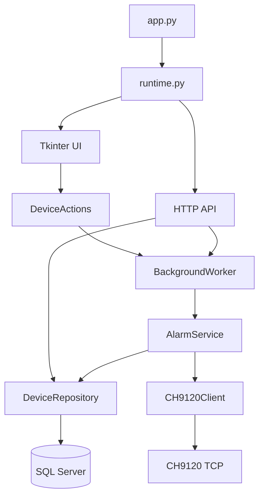

# Kiến trúc ứng dụng

## Luồng phụ thuộc

## Trách nhiệm

- `Settings`: đọc cấu hình và cung cấp dữ liệu; không mở kết nối.
- `ConfigDocument`: kiểm tra và ghi file YAML theo đường dẫn khởi động; lưu bản sao, giữ khóa mở rộng và phát hiện thay đổi bên ngoài.
- `SettingsTab`: form cấu hình và trình sửa danh sách lệnh. `Runtime.apply_settings` cập nhật dependency trên event loop khi không có yêu cầu đang hoạt động; cấu hình bind server được hoãn tới lần khởi động tiếp theo.
- `DeviceRepository`: SQL có tham số, transaction, đóng cursor và connection.
- `CH9120Client`: kết nối có timeout, gửi frame, nhận phản hồi và đóng socket.
- `AlarmService`: xác định mục tiêu, loại endpoint trùng, quản lý thời lượng, gửi lệnh tắt khi kết thúc hoặc bị hủy, thay thế tác vụ cũ theo endpoint và tổng hợp kết quả. Chỉ gọi service bất đồng bộ qua event loop dùng chung.
- `BackgroundWorker`: sở hữu event loop, nhận coroutine từ API/UI, quản lý kết quả job và hủy tác vụ khi đóng ứng dụng.
- `RequestHistory`: lưu trạng thái, metadata và sự kiện log cho mỗi yêu cầu; bảo vệ dữ liệu dùng chung giữa worker, HTTP và Tkinter bằng lock. `ContextVar` truyền Request ID tới các tác vụ thiết bị và log liên quan. Handler ghi file bổ sung cùng mã để tra cứu trên đĩa.
- `DeviceActions`: adapter để UI nhận future; không phụ thuộc Flask hoặc Tkinter.
- `api`: kiểm tra HTTP input, xác thực khóa nếu có, trả response và chuyển yêu cầu tới các dependency.
- `ui`: chỉ cập nhật widget trên luồng Tkinter; theo dõi future bằng `after`.
- `RequestLogTab`: bảng theo dõi yêu cầu và chi tiết thiết bị/log. Mỗi lần cập nhật lấy snapshot từ RequestHistory, giữ lựa chọn đang xem và không đọc lại toàn bộ file log.
- `ui/theme.py`: bảng màu tối và các thành phần Tk dùng chung. Màn hình điều khiển tách khu vực tìm thiết bị với bảng gửi lệnh; nút xem yêu cầu chuyển tab và chọn bằng ID đầy đủ.
- `ui/widgets.py`: các thành phần Tk tự vẽ cho nút, ô nhập, tab và thanh cuộn. Nút hỗ trợ chuột, Enter, Space, focus và trạng thái vô hiệu; thanh cuộn tự ẩn và hỗ trợ kéo thumb. Ô nhập giữ widget Entry/Combobox bên trong; phần xem log giữ Text để hỗ trợ chọn và sao chép nội dung.

## Vòng đời

Ứng dụng đọc cấu hình, cấu hình logging, tạo repository/client/service và khởi động worker. HTTP server được bind trước khi giao diện hoạt động, vì vậy lỗi bind không bị giấu trong thread nền.

Khi đóng giao diện, ứng dụng ngừng nhận HTTP, hủy tác vụ nền và chờ bước dọn dẹp thiết bị trước khi dừng event loop. Thời gian chờ đóng worker có giới hạn; nếu vượt giới hạn, ghi lỗi vào log. Tắt cưỡng bức tiến trình hoặc mất mạng vẫn có thể ngăn thiết bị nhận lệnh tắt.

## Phạm vi và giới hạn

Ứng dụng hiện phục vụ một tiến trình. Trạng thái điều phối thiết bị và job nằm trong bộ nhớ; chạy nhiều tiến trình độc lập sẽ không chia sẻ bộ hẹn giờ. Không triển khai nhiều worker trên cùng tập thiết bị nếu chưa có bộ điều phối chung.

HTTP server tích hợp phục vụ ứng dụng desktop hoặc môi trường nội bộ. Xác thực bằng API key là tùy chọn và chưa có phân quyền theo người dùng. Phản hồi thiết bị hiện được giữ dưới dạng HEX; chưa giải mã để xác nhận trạng thái vật lý.

Các thay đổi API, cách cấu hình và trạng thái chưa test được ghi trong README.
